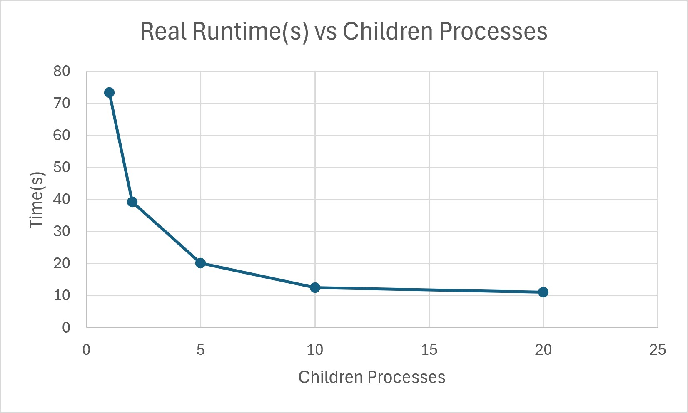

# Lab 11: Multiprocessing
## Purpose:
  Demonstrate multiprocessing by using child processes to generate images of the mandelbrot set, and then create a video with these images in ffmpeg
## Implementation:
 My implementation uses getopt to parse the input for the number of children. Upon getting the children count, it will loop for the number of frames, making sure that the number of children is less than the number of remaining frames. If the number of remaining frames is less than the number of children, it will decrease our number of children to the remaining number of frames. It will then fork for our number of children, having each child make a new image with a different scale and filename corresponding to its value i, as well as the current frame count. The code then waits for each child to be done, and then decrements frames for the number of children. It will then use ffmpeg to generate an mp4 using our mandel images, and then, as an added quality-of-life feature, it will delete all the mandel images, leaving just the video.
## Results

## Discussion of results
  We can see a sizeable improvement with the first 3 data points, although we do begin to see diminishing marginal returns after 10 processes, as our runtimes between 10 and 20 are pretty close to each other. I believe this is likely because we have 14 processors on these computers, which means that after 14 processes the computers will begin to need to share cores to continue doing processes.
